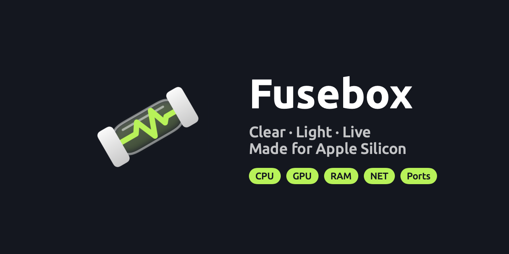

<p align="center"></p>

<h1 align="center">Fusebox (beta)</h1>

**Clear · Light · Live.** A Mac activity monitor made for Apple Silicon: CPU, GPU, RAM, temperature, internet, SSD and ports, which apps use the most, and advice.

> **Beta.** Fusebox is still in development. Expect rough edges; updates arrive automatically.

**Runs on:** a Mac with Apple silicon (M1 or newer) and macOS 26 or newer.

## Install

**Easiest (no security warning):** open **Terminal** and paste this one line, then press Return:

```bash
curl -sL https://github.com/JoelonHTML/Fusebox/releases/latest/download/Fusebox.zip -o /tmp/Fusebox.zip && mkdir -p ~/Applications && ditto -x -k /tmp/Fusebox.zip ~/Applications && open ~/Applications/Fusebox.app
```

It downloads the latest Fusebox into your Applications folder and opens it. A short setup follows: one question per step (style, what to show, menu bar, notifications…). You can change everything later in Settings.

**Or by hand (download from the Releases page):**

1. Unzip `Fusebox.zip` and drag **Fusebox** into your **Applications** folder.
2. Open it. macOS says *"Fusebox" not opened – Apple could not verify…*, because Fusebox isn't notarised by Apple. Click **Done** (not Move to Trash).
3. Go to **System Settings → Privacy & Security**, scroll down to *"Fusebox" was blocked…* and click **Open Anyway**, then confirm with your password. You only need to do this once.

## Update

Fusebox updates itself: it checks GitHub every 15 minutes, installs new versions (only ones signed by its maker) and tells you what's new. No security warning for updates. Your settings and history stay.

## Use

- **Live:** drag the window larger for more columns, graphs and facts. Click a card for a full detail view of that measurement (5 min / 1 hour / today, min/avg/max and much more).
- **Processes:** click a row for a plain-language explanation, and **Details** for a page per app: live CPU, memory, energy and GPU, history (average, peak, when you use it, share of your Mac's energy) and info about the app. Search (⌘F) finds running and installed apps. Use ✕ to quit an app. Optional: internet use per app.
- **Checkup:** why your Mac is slow, health score, crashes, battery health, tips and a shareable report.
- **Network:** every device on your network (name, IP, maker, type, ms), scan any IP range, search, router vs. internet speed and Wi-Fi signal. macOS asks once for Local Network access.
- **Docked:** what is plugged into your Mac: power coming in, charger, cable (e-marker), link speed now vs. maximum, and the devices behind a dock.
- **Fans** (MacBook Pro, Mac Studio, Mac mini): live fan speed, and in Settings › Fans your own fan curve. Control needs a small helper that asks for your password once; Fusebox never runs fans slower than macOS's minimum.
- **Settings (gear):** style, font, which measurements you see and in what order, graphs, menu bar, notifications and a keyboard shortcut (⌃⌥⌘F) to show or hide Fusebox.

Measurements are saved in `Documents/Fusebox` as CSV (one small file per day; open the folder via Settings → Privacy). Nothing goes to the internet, except a short connection to measure latency (ms), checking GitHub for updates, and a speed test only when you start one. You choose the latency address yourself in Settings.
